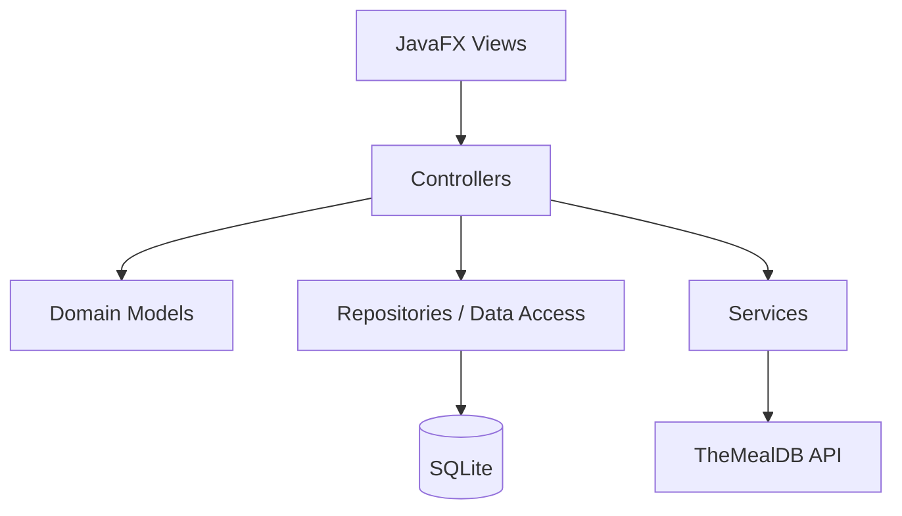
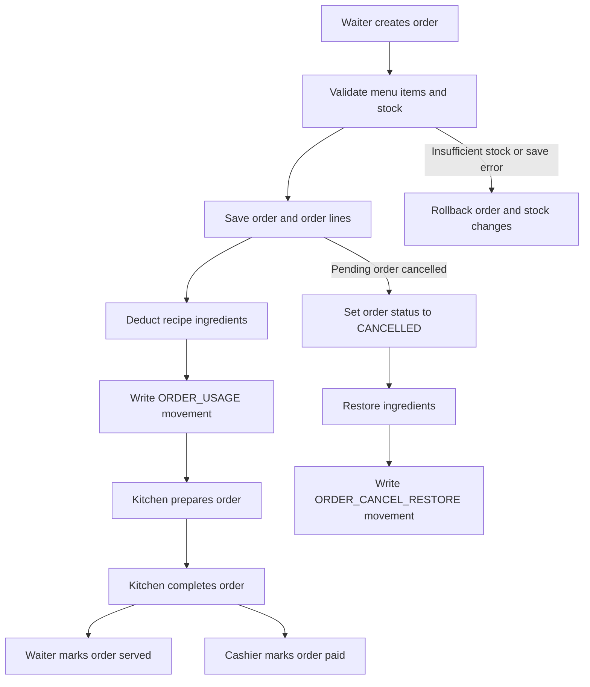

# DineSmart Restaurant Ordering and Inventory Insights

**CPE 314 · Software Design · Section 3B · Team 05 · Milestone 2 (Week 10) Design Document**

Repository: `ambuhotjam/cpe314--69323--capstone-team-05`

## 1. Introduction

DineSmart is a Java desktop application for restaurant ordering and inventory insights. It brings together menu maintenance, recipe discovery, customer orders, kitchen preparation, cashier payment, waiter service, reservations, ingredient stock, and reports in one local application.

The application uses JavaFX for its desktop interface, SQLite for persistent data, and TheMealDB as its public recipe API. Staff sign in with individual accounts and receive role-based access to the operational areas.

## 2. Users, roles, and permissions

The four operational roles are **SUPERVISOR, WAITER, CASHIER, and KITCHEN**. The repository also retains an `ADMIN` compatibility role for the seeded administrator account; both `ADMIN` and `SUPERVISOR` receive management-level permissions.

| Capability | SUPERVISOR | WAITER | CASHIER | KITCHEN |
|---|:---:|:---:|:---:|:---:|
| Dashboard and reports | Yes | No | No | No |
| View menu | Yes | Yes | No | Yes |
| Create customer orders | Yes | Yes | No | No |
| View active order queue | Yes | Yes | No | Yes |
| Prepare and complete orders | Yes | No | No | Yes |
| Mark orders as served | Yes | Yes | No | No |
| View cashier bills | Yes | No | Yes | No |
| Mark orders as paid | Yes | No | Yes | No |
| View ingredient inventory | Yes | No | No | Yes |
| Add, remove, or adjust ingredient stock | Yes | No | No | No |
| Manage menu items and prices | Yes | No | No | No |
| Manage reservations | Yes | No | No | No |
| Manage staff accounts | Yes | No | No | No |
| Cancel orders and reset restaurant data | Yes | No | No | No |

The policy is centralized in `service/StaffPermissions`. Controllers call the policy before protected repository actions. The JavaFX navigation also hides pages and controls that a role cannot use. Unknown and blank roles are denied by default.

Staff passwords are stored as salted PBKDF2 hashes. `AuthRepository` supports authentication, staff-account creation, account activation/deactivation, and password reset. Order records store an optional `created_by` staff-user foreign key so the application can filter a signed-in user's orders and group daily completed sales by staff account.

## 3. Architecture and MVC design

The target dependency direction is:

Package responsibilities:

| Package | Responsibility |
|---|---|
| `ui` | JavaFX screens, controls, navigation, and presentation |
| `controller` | Role-aware application actions and coordination |
| `model` | Plain domain models such as `MenuItem` and `MealRecipe` |
| `dto` | Data-transfer objects that mirror external API response fields |
| `service` | TheMealDB client and mapper, role policy, order queues, stacks, and photo storage |
| `data` | SQLite connection, schema migrations, write-oriented repositories, and `OrderReportRepository` for read-only analytics |
| `util` | Shared utilities, including exact-cent currency conversion |

The view should not own SQL or API requests. Controllers receive repositories and services through their constructors and coordinate the work. The model should not import JavaFX or database classes. The `DineSmartApp` class currently remains the main JavaFX composition and screen class; the controller layer has been introduced and wired into authentication, order, menu, inventory, reservation, and report workflows. Full extraction of each screen into a separate view class remains listed in `KNOWN_ISSUES.md`.

### Figure 1. Application dependency direction

The flowchart above shows the intended one-way dependency: views call controllers; controllers coordinate models, repositories, and services; repositories communicate with SQLite; and the API service communicates with TheMealDB.

## 4. Database design

The schema contains 16 tables:

1. `menu_items`
2. `restaurant_orders`
3. `order_items`
4. `order_combo_items`
5. `ingredients`
6. `menu_item_ingredients`
7. `staff_users`
8. `menu_periods`
9. `recipe_catalog`
10. `recipe_ingredients`
11. `table_reservations`
12. `menu_recommendations`
13. `ingredient_movements`
14. `combos`
15. `combo_components`
16. `restaurant_tables`

The final ERD is Figure 3 in [`erd.md`](erd.md) and the committed image [`erd.png`](erd.png). It includes every table, the foreign-key relationships, and the relationship cardinalities.

`restaurant_tables` is the normalized table master. `table_reservations.table_id` and `restaurant_orders.table_id` reference it. The readable `table_label` in reservations is retained for compatibility and display.

`ingredient_movements.order_id` references `restaurant_orders.order_id` with `ON DELETE SET NULL`. This preserves movement history if an order is later removed while preventing an orphan order identifier.

### Money representation

All application money calculations use integer cents:

- `menu_items.price_cents`
- `order_items.unit_price_cents`
- `order_combo_items.unit_price_cents`
- `combos.discount_basis_points`

Order-time prices are snapshots, so later menu price changes do not rewrite historical order totals. The older decimal columns remain compatibility mirrors for databases created by earlier DineSmart versions. Ingredient quantities are physical measurements, not money, and remain decimal quantities.

### Figure 2. Order and inventory lifecycle

The placement and cancellation operations use database transactions. Cancellation restores only the quantities recorded as `ORDER_USAGE` and writes a matching `ORDER_CANCEL_RESTORE` movement. A repeat cancellation is rejected, and the restore method also checks for an existing restore movement.

## 5. API integration design

**Public API:** TheMealDB.

**Base endpoint:** `https://www.themealdb.com/api/json/v1/1/`

| Operation | Endpoint | Use |
|---|---|---|
| Search by name | `search.php?s=` | Search recipe names |
| Search category | `filter.php?c=` | Browse categories such as Starter and Main Course |
| Recipe details | `lookup.php?i=` | Load a full recipe by meal ID |
| Food photo | TheMealDB `strMealThumb` URL | Download a verified dish thumbnail |

The JSON response contains a `meals` array or `null`. A meal contains `idMeal`, `strMeal`, category, area, instructions, thumbnail URL, and up to 20 numbered ingredient and measure pairs.

`dto/MealDbMealDto` mirrors the source response shape. `service/MealDbMealMapper` converts the DTO to the `model/MealRecipe` domain record. `TheMealDbService` returns domain recipes to its caller; it does not write to SQLite.

The HTTP client uses a 10-second connection timeout, a 20-second API request timeout, and a 25-second image request timeout. Non-2xx HTTP responses and invalid JSON are reported as `IOException`. `ApiResult<T>` also exposes `OK`, `EMPTY`, and `FAILED` states with a non-null data value and a human-readable message for controller-facing calls. Thumbnail downloads require HTTPS, a TheMealDB host, the expected meals image path, an image content type, and a bounded file size.

The API unit tests use a local HTTP server for successful responses, empty results, HTTP errors, timeouts, and malformed JSON. They do not depend on the public network.

## 6. Concurrency design

Blocking HTTP calls, recipe imports, historical analysis, and automatic photo lookups run away from the JavaFX application thread using a shared fixed-size executor named `dinesmart-io`. `DineSmartApp` shuts the executor down when the application stops.

The UI uses `CompletableFuture` for background work and `Platform.runLater` to update JavaFX controls on the JavaFX application thread. Search, category browsing, recipe import, and historical analysis show progress status and disable the initiating button while the operation is running. Errors are returned to the UI through the completion handler instead of being silently discarded.

## 7. Data mining and visualization design

The application derives its charts and summaries from live SQLite queries:

| Insight | Aggregation | Visualization |
|---|---|---|
| Menu category frequency | Count saved menu items grouped by `item_type` | Bar chart |
| Best sellers | Sum ordered quantities for completed orders, grouped by menu item | Bar chart |
| Orders by hour | Count non-cancelled orders grouped by the hour of `ordered_at` | Line chart |
| Today's sales | Sum order quantity multiplied by exact order-time cents for completed orders | Numeric sales summary |
| Daily sales by staff | Group completed-order cents by `restaurant_orders.created_by` | Staff sales list |
| Historical order analysis | Count total, completed, and cancelled orders; include peak hour and best sellers | Text report |

Cancelled orders are excluded from sales and best-seller totals. The order-hour chart includes all 24 hours, including hours with zero orders.

## 8. Revision history

| Date | Revision |
|---|---|
| 11 November 2026 | Week 10 review update: added the normalized restaurant table relationship, order and movement foreign keys, exact-cent money columns, cancellation restoration checks, role-protected controllers, TheMealDB DTO/mapper and local-server tests, per-staff order attribution, and the 16-table ERD. |
| 11 November 2026 | Consolidated the design document and added the requirements map and known-issues register for the Milestone 2 submission. |

This document describes the repository contents included with this update. Any remaining work is recorded in `KNOWN_ISSUES.md` rather than being represented as completed.
