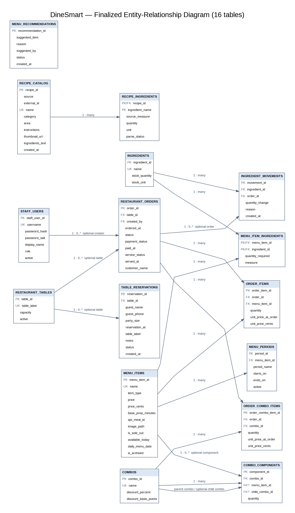
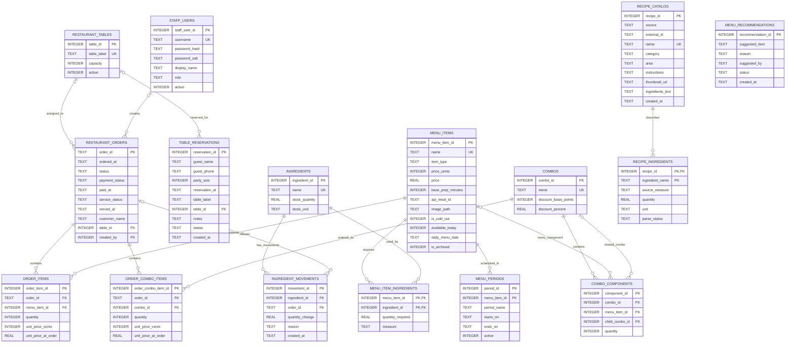

# DineSmart Entity-Relationship Diagram

**CPE 314 · Section 3B · Team 05 · Milestone 2 (Week 10)**

The schema contains the 15 original application tables plus `restaurant_tables`, added to normalize table assignments. The current ERD therefore contains **16 tables**.

## Mermaid ERD

## Relationship cardinalities

| Parent | Child | Cardinality | Meaning |
|---|---|---:|---|
| `restaurant_tables` | `restaurant_orders` | 1 to 0..many | An order may be unassigned to a table; a table can be linked to many orders over time. |
| `staff_users` | `restaurant_orders` | 1 to 0..many | `created_by` is optional for imported or historical orders. |
| `restaurant_tables` | `table_reservations` | 1 to 0..many | A reservation may be unassigned; assigned reservations reference one table. |
| `restaurant_orders` | `order_items` | 1 to many | Each order item belongs to one order. |
| `menu_items` | `order_items` | 1 to many | Each order item references one menu item. |
| `restaurant_orders` | `order_combo_items` | 1 to many | Each combo order line belongs to one order. |
| `combos` | `order_combo_items` | 1 to many | Each combo order line references one combo. |
| `menu_items` | `menu_item_ingredients` | 1 to many | One menu item can require multiple ingredients. |
| `ingredients` | `menu_item_ingredients` | 1 to many | One ingredient can be used by multiple menu items. |
| `menu_items` | `menu_periods` | 1 to many | A menu item can have multiple meal-period schedules. |
| `recipe_catalog` | `recipe_ingredients` | 1 to many | A recipe can contain multiple ingredient descriptions. |
| `ingredients` | `ingredient_movements` | 1 to many | An ingredient has an inventory movement history. |
| `restaurant_orders` | `ingredient_movements` | 1 to many, optional | Order-related movements point to an order; manual movements may have a null order ID. |
| `combos` | `combo_components` | 1 to many | A combo can contain menu items or nested combos. |
| `menu_items` | `combo_components` | 1 to many, optional | A component may reference a menu item. |
| `combos` | `combo_components` | 1 to many, optional self-reference | A component may reference a child combo. |

## Schema notes

- `menu_items.price_cents` is the canonical selling price. The old `price` column is retained and updated as a compatibility mirror for older database files.
- `order_items.unit_price_cents` and `order_combo_items.unit_price_cents` preserve the exact order-time price. The old `unit_price_at_order` columns remain compatibility mirrors.
- `combos.discount_basis_points` is the canonical integer discount percentage representation (100 basis points = 1%). `discount_percent` is retained for older databases.
- `table_reservations.table_label` remains as a readable legacy field; `table_id` is the normalized foreign-key relationship.
- `ingredient_movements.order_id` now references `restaurant_orders.order_id` with `ON DELETE SET NULL`.
- `recipe_ingredients.ingredient_name` and `menu_recommendations.suggested_by` are descriptive text fields, not foreign keys in the current schema.
