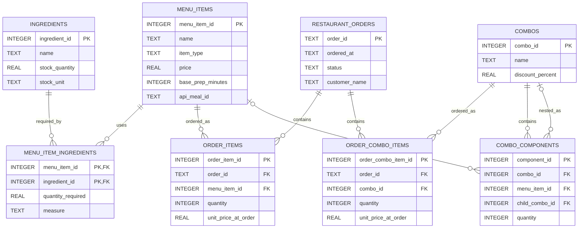

CPE 314 — Software Design

University of Cebu

Computer Engineering Department

# Restaurant Ordering & Inventory Insights

Project Design Document

 

| | |
|---|---|
| **Group Name / No.:** | Group 5 |
| **Members:** | Kiro Del Rosario- Team Leader |
| | Jamaica Ambuhot- Developer 1 |
| | Janine Ebrado- Developer 2 |
| | Josiela Yap- UI (User Interface) |
| | Vincent Hayag- DB Admin |
| | Ben Justin Lajot- QA (Quality Assurance) |
| **Instructor:** | Richyll Son |
| **Term:** | First Semester, S.Y. 2026-2027 |
| **Document Version / Date:** | Ver 0.1 - October 20, 2026 |

 

## Table of Contents

<h2>Revision History</h2>

<strong>Table 1: Revision history</strong>

<table>
  <thead>
    <tr>
      <th style="text-align: center;">Version</th>
      <th width="140">Date</th>
      <th>Author</th>
      <th>Changes</th>
    </tr>
  </thead>
  <tbody>
    <tr>
      <td align="center" valign="top"><b>0.1</b></td>
      <td valign="top" width="140">
        October&nbsp;20,&nbsp;2026 
        October&nbsp;25,&nbsp;2026
      </td>
      <td valign="top">
        Group 5 
        <b>Ambuhot</b> - Introduction 
        <b>Ebrado</b> - ER Sketch 
        <b>Yap</b> - Feature Checklist 
        <b>Del Rosario</b> - Task Split 
        <b>Hayag</b> - The Public API 
        <b>Lajot</b> - Risk/Questions
      </td>
      <td valign="top">
        Initial draft 
        Completed the Week 8 project proposal, including the introduction, ER sketch, feature checklist, task split, public API, and risks/questions.
      </td>
    </tr>
    <tr>
      <td align="center" valign="top"><b>0.2</b></td>
      <td valign="top" width="140">October&nbsp;26,&nbsp;2026</td>
      <td valign="top">
        <b>Yap &amp; Hayag</b> - Class Hierarchy Diagram/Description 
        <b>Ambuhot</b> - SRP Justification 
        <b>Ebrado</b> - Finalized ERD 
        <b>Del Rosario &amp; Lajot</b> - Schema Description
      </td>
      <td valign="top">
        Added Week 9 design and documentation sections, including the Class Hierarchy Diagram, SRP Justification, Finalized ERD, and Schema Description.
      </td>
    </tr>
    <tr>
      <td align="center"><b>0.3</b></td>
      <td></td>
      <td></td>
      <td>Week 10 sections added</td>
    </tr>
    <tr>
      <td align="center"><b>1.0</b></td>
      <td></td>
      <td></td>
      <td>Final compilation and polish — Week 11</td>
    </tr>
  </tbody>
</table>

## 1. Introduction & Project Overview
The Restaurant Ordering & Inventory Insights is a JavaFX desktop application designed for small restaurants and campus canteens that need an efficient way to manage orders and ingredient inventory. The application will manage menu items, nested meal combos, and the kitchen order queue while integrating with TheMealDB to import real recipe information. It will use SQLite to store records and generate charts showing best-selling menu items and peak ordering hours, helping staff improve food preparation and inventory management.

## 2. Preliminary ER Sketch & Team Roles

  <em>Figure 1: Restaurant Ordering & Inventory System Diagram</em>

## Team Roles

Table 1: Team members and proposed responsibilities

| Member | Role |
|---|---|
| Kiro Del Rosario - Team Leader | TheMealDB integration and background CSV-import plan. |
| Jamaica Ambuhot - Developer 1 | OOD hierarchy and recursive combo pricing plan. |
| Janine Ebrado - Developer 2 | ER sketch and SQLite/JDBC data-layer plan. |
| Vincent Hayag - DB Admin | Kitchen Queue, cancellation Stack and stock-flow plan. |
| Josiela Yap - UI (User Interface) | JavaFX screen sketch and event-handler plan. |
| Ben Justin Lajot - QA (Quality Assurance) | JUnit test cases, sales aggregation and chart plan. |

# 3. System Architecture & Object-Oriented Design

## 3.1 Class Hierarchy

The class hierarchy diagram illustrates the inheritance relationships among the menu-related classes of the Restaurant Ordering & Inventory Insights application. It consists of one abstract superclass, `MenuItem`, and four concrete subclasses: `Appetizer`, `MainCourse`, `Beverage`, and `Combo`.

This structure organizes menu items according to their categories while promoting code reusability and maintainability.

### 3.1.1 MenuItem (Abstract Superclass)

The `MenuItem` class serves as the abstract superclass for all menu items in the application. It stores and validates common menu-item information and provides a shared structure for its subclasses. This design reduces code duplication and establishes a consistent way of representing menu items throughout the application.

### 3.1.2 Appetizer (Concrete Subclass)

The `Appetizer` class extends the `MenuItem` class and represents appetizer items offered by the restaurant. It inherits the common menu-item information and behavior defined by its superclass while identifying items belonging to the appetizer category.

### 3.1.3 MainCourse (Concrete Subclass)

The `MainCourse` class extends the `MenuItem` class and represents the main-course items available on the restaurant's menu. It inherits the common menu-item information and behavior defined by its superclass while distinguishing main-course items from other menu categories.

### 3.1.4 Beverage (Concrete Subclass)

The `Beverage` class extends the `MenuItem` class and represents beverages offered by the restaurant. It inherits the common menu-item information and behavior defined by its superclass while identifying items belonging to the beverage category.

### 3.1.5 Combo (Concrete Subclass)

The `Combo` class extends the `MenuItem` class and represents combinations of individual menu items or other combos. It maintains combo components, recursively calculates the total price of nested combos, validates component quantities, and prevents circular references.

## 3.2 Single Responsibility Principle (SRP) Justification

The application follows the Single Responsibility Principle by assigning specific responsibilities to its classes:

- **MenuItem:** Stores and validates common menu-item information. It does not manage the user interface or database operations.
- **Appetizer:** Represents appetizer menu items and their category.
- **MainCourse:** Represents main-course menu items and their category.
- **Beverage:** Represents beverage menu items and their category.
- **Combo:** Manages combo components, calculates nested combo prices recursively, and prevents invalid quantities and circular references.
- **RestaurantOrder:** Stores the order ID, timestamp, and status and ensures that order-status transitions follow the defined rules.
- **KitchenQueue:** Manages FIFO (First-In, First-Out) processing of kitchen orders.
- **OrderHistoryStack:** Tracks recent orders and supports cancellation of the latest order that is still pending.
- **Database:** Manages SQLite database connections and initializes the database schema.
- **MenuItemRepository:** Handles saving, retrieving, and other database operations for menu items using parameterized JDBC statements.
- **DineSmartApp:** Builds the JavaFX interface, handles user interactions, and delegates operations to the appropriate application services and repositories.

Each class has a specific responsibility, separating menu management, combo pricing, order processing, database operations, and user-interface functions. This design improves organization, reduces code duplication, and makes individual classes easier to maintain and test.

---

# 4. Data Model & Database Design

## 4.1 Finalized Entity-Relationship Diagram (ERD)

The Entity-Relationship Diagram (ERD) illustrates the relational database structure of the DineSmart Restaurant Ordering & Inventory Insights application. The application uses SQLite as its database management system and Java Database Connectivity (JDBC) to execute database operations.

The database consists of eight application tables:

1. `MENU_ITEMS`
2. `INGREDIENTS`
3. `MENU_ITEM_INGREDIENTS`
4. `RESTAURANT_ORDERS`
5. `ORDER_ITEMS`
6. `ORDER_COMBO_ITEMS`
7. `COMBOS`
8. `COMBO_COMPONENTS`

These tables support menu management, ingredient records, customer orders, and meal combo management. Primary keys (PKs) uniquely identify records, while foreign keys (FKs) establish relationships between related tables.

**Figure 3.** Finalized eight-table Entity-Relationship Diagram showing the database entities, primary keys, foreign keys, and relationships of DineSmart.

## 4.2 Entity and Attribute Definitions

**Table 3: Database Entities and Their Key Attributes**

| Entity | Key Attributes | Description |
|---|---|---|
| `MENU_ITEMS` | `menu_item_id` (INTEGER, PK), `name` (TEXT), `item_type` (TEXT), `price` (REAL), `base_prep_minutes` (INTEGER), `api_meal_id` (TEXT) | Stores restaurant menu items, including their names, categories, prices, preparation estimates, and optional TheMealDB identifiers. |
| `INGREDIENTS` | `ingredient_id` (INTEGER, PK), `name` (TEXT), `stock_quantity` (REAL), `stock_unit` (TEXT) | Stores ingredient information, available stock quantities, and measurement units. |
| `MENU_ITEM_INGREDIENTS` | `menu_item_id` (INTEGER, PK/FK), `ingredient_id` (INTEGER, PK/FK), `quantity_required` (REAL), `measure` (TEXT) | Connects menu items with their required ingredients and records the quantities needed for preparation. |
| `RESTAURANT_ORDERS` | `order_id` (TEXT, PK), `ordered_at` (TEXT), `status` (TEXT), `customer_name` (TEXT) | Stores customer orders, timestamps, order statuses, and customer names. |
| `ORDER_ITEMS` | `order_item_id` (INTEGER, PK), `order_id` (TEXT, FK), `menu_item_id` (INTEGER, FK), `quantity` (INTEGER), `unit_price_at_order` (REAL) | Stores individual menu items included in customer orders, their quantities, and their recorded prices. |
| `ORDER_COMBO_ITEMS` | `order_combo_item_id` (INTEGER, PK), `order_id` (TEXT, FK), `combo_id` (INTEGER, FK), `quantity` (INTEGER), `unit_price_at_order` (REAL) | Stores meal combos included in customer orders, including their quantities and recorded prices. |
| `COMBOS` | `combo_id` (INTEGER, PK), `name` (TEXT), `discount_percent` (REAL) | Stores meal combos, their names, and applicable discount percentages. |
| `COMBO_COMPONENTS` | `component_id` (INTEGER, PK), `combo_id` (INTEGER, FK), `menu_item_id` (INTEGER, nullable FK), `child_combo_id` (INTEGER, nullable FK), `quantity` (INTEGER) | Stores the individual menu items or nested combos that make up a meal combo. |

The database uses SQLite data types such as INTEGER, TEXT, and REAL to store identifiers, names, timestamps, quantities, and monetary values.

The `customer_name` attribute is added to `RESTAURANT_ORDERS` through a database migration for existing databases. Similarly, `discount_percent` is added to older `COMBOS` tables when necessary.

## 4.3 SQLite Schema Description

The DineSmart database schema is implemented using SQLite. Primary keys uniquely identify records, while foreign keys establish relationships between related tables. UNIQUE and CHECK constraints help maintain data integrity. JDBC PreparedStatements are used to bind values in database operations.

**Table 4: SQLite Schema Description (Key Columns and Purpose)**

| Table | Key Columns | Purpose |
|---|---|---|
| `MENU_ITEMS` | `menu_item_id` (PK), `name` (UNIQUE), `item_type`, `price`, `base_prep_minutes`, `api_meal_id` | Stores menu items, categories, selling prices, preparation estimates, and optional TheMealDB identifiers. |
| `INGREDIENTS` | `ingredient_id` (PK), `name` (UNIQUE), `stock_quantity`, `stock_unit` | Stores ingredient information and available inventory quantities. |
| `MENU_ITEM_INGREDIENTS` | `menu_item_id` (PK/FK), `ingredient_id` (PK/FK), `quantity_required`, `measure` | Connects menu items to ingredients and records recipe requirements. |
| `RESTAURANT_ORDERS` | `order_id` (PK), `ordered_at`, `status`, `customer_name` | Stores customer orders, timestamps, statuses, and customer names. |
| `ORDER_ITEMS` | `order_item_id` (PK), `order_id` (FK), `menu_item_id` (FK), `quantity`, `unit_price_at_order` | Stores individual menu items included in customer orders. |
| `ORDER_COMBO_ITEMS` | `order_combo_item_id` (PK), `order_id` (FK), `combo_id` (FK), `quantity`, `unit_price_at_order` | Stores combos included in customer orders, including quantities and recorded prices. |
| `COMBOS` | `combo_id` (PK), `name` (UNIQUE), `discount_percent` | Stores named meal combos and their discount percentages. |
| `COMBO_COMPONENTS` | `component_id` (PK), `combo_id` (FK), `menu_item_id` (nullable FK), `child_combo_id` (nullable FK), `quantity` | Stores the menu items or nested combos that make up each combo. |

The schema uses primary keys, foreign keys, UNIQUE constraints, and CHECK constraints to maintain data consistency. Foreign-key enforcement is enabled when a database connection is established.

The `COMBO_COMPONENTS` table also includes a CHECK constraint requiring exactly one of `menu_item_id` or `child_combo_id` to contain a value. This allows a combo component to reference either an individual menu item or another combo, but not both simultaneously.

## 4.4 Primary Keys and Foreign Keys

Primary keys (PKs) uniquely identify individual records within a database table. Foreign keys (FKs) establish relationships between related records and help maintain referential integrity.

The primary keys used in the database include:

- `MENU_ITEMS.menu_item_id`
- `INGREDIENTS.ingredient_id`
- `RESTAURANT_ORDERS.order_id`
- `ORDER_ITEMS.order_item_id`
- `ORDER_COMBO_ITEMS.order_combo_item_id`
- `COMBOS.combo_id`
- `COMBO_COMPONENTS.component_id`

The `MENU_ITEM_INGREDIENTS` table uses a composite primary key consisting of `menu_item_id` and `ingredient_id`. This prevents duplicate ingredient associations for the same menu item.

The following foreign-key relationships connect the database tables:

- `MENU_ITEM_INGREDIENTS.menu_item_id` references `MENU_ITEMS.menu_item_id`.
- `MENU_ITEM_INGREDIENTS.ingredient_id` references `INGREDIENTS.ingredient_id`.
- `ORDER_ITEMS.order_id` references `RESTAURANT_ORDERS.order_id`.
- `ORDER_ITEMS.menu_item_id` references `MENU_ITEMS.menu_item_id`.
- `ORDER_COMBO_ITEMS.order_id` references `RESTAURANT_ORDERS.order_id`.
- `ORDER_COMBO_ITEMS.combo_id` references `COMBOS.combo_id`.
- `COMBO_COMPONENTS.combo_id` references `COMBOS.combo_id`.
- `COMBO_COMPONENTS.menu_item_id` references `MENU_ITEMS.menu_item_id`.
- `COMBO_COMPONENTS.child_combo_id` references `COMBOS.combo_id`.

The `COMBO_COMPONENTS` table supports nested combos through the self-referencing `child_combo_id` foreign key.

## 4.5 Database Relationships

**Table 5: Database Relationships and Their Descriptions**

| Relationship | Cardinality | Description |
|---|---|---|
| `MENU_ITEMS` and `INGREDIENTS` through `MENU_ITEM_INGREDIENTS` | Many-to-many | A menu item can require multiple ingredients, while an ingredient can be used in multiple menu items. |
| `RESTAURANT_ORDERS` and `ORDER_ITEMS` | One-to-many | A customer order can contain multiple individual menu-item entries. |
| `MENU_ITEMS` and `ORDER_ITEMS` | One-to-many | A menu item can appear in multiple customer order records. |
| `RESTAURANT_ORDERS` and `ORDER_COMBO_ITEMS` | One-to-many | A customer order can contain multiple combo entries. |
| `COMBOS` and `ORDER_COMBO_ITEMS` | One-to-many | A combo can appear in multiple customer orders. |
| `COMBOS` and `COMBO_COMPONENTS` | One-to-many | A combo can contain multiple components. |
| `MENU_ITEMS` and `COMBO_COMPONENTS` | One-to-many, optional | A combo component may reference an individual menu item. |
| `COMBOS` and `COMBO_COMPONENTS` through `child_combo_id` | One-to-many, optional self-reference | A combo component may reference another combo, allowing nested combos. |

The `MENU_ITEM_INGREDIENTS` table resolves the many-to-many relationship between menu items and ingredients.

The `ORDER_ITEMS` and `ORDER_COMBO_ITEMS` tables separate individual menu-item orders from combo orders. This allows customer orders to contain regular menu items and meal combos.

The `COMBO_COMPONENTS` table supports nested combo structures by allowing a combo to contain either individual menu items or other combos.

## 4.6 Design Rules and Constraints

The database and application apply validation rules to maintain accurate and consistent records.

### 4.6.1 Menu Item Constraints

- Menu-item names are required and must be unique.
- Menu-item prices cannot be negative.
- Preparation times cannot be negative.
- The `item_type` field accepts the supported values `APPETIZER`, `MAIN_COURSE`, and `BEVERAGE`.
- The `api_meal_id` field can store an optional TheMealDB recipe identifier.

### 4.6.2 Ingredient Constraints

- Ingredient names are required and unique.
- Ingredient stock quantities cannot be negative.
- Required ingredient quantities must be positive.
- Each menu-item and ingredient association is uniquely identified by its composite primary key.

### 4.6.3 Order Constraints

- Each order must have a unique order identifier.
- Order timestamps are required.
- Order statuses must be one of the supported values: `PENDING`, `PREPARING`, `COMPLETED`, or `CANCELLED`.
- Order-item quantities must be positive.
- Combo-order quantities must be positive.
- Recorded unit prices cannot be negative.

The `ORDER_ITEMS` and `ORDER_COMBO_ITEMS` tables store `unit_price_at_order`. This preserves the recorded price of an item or combo even if its current price changes later.

### 4.6.4 Combo Constraints

- Combo names are required and unique.
- Combo discounts must be at least zero and less than 100 percent.
- Combo-component quantities must be positive.
- Each combo component must reference either an individual menu item or another combo.
- Circular combo references are prevented through application-level validation.
- Nested combo prices are calculated recursively.

The `COMBO_COMPONENTS` table uses a CHECK constraint to ensure that exactly one of `menu_item_id` or `child_combo_id` is provided for each component record.

### 4.6.5 Referential Integrity

Foreign-key relationships help prevent invalid references between database tables.

The application enables SQLite foreign-key enforcement whenever a database connection is established through the `Database.connect()` method.

These constraints help maintain consistency among menu items, ingredients, customer orders, combos, and combo components.

## 4.7 Database Support for Application Features

The database provides the relational foundation for the main functions of the DineSmart application.

### Menu Management

The `MENU_ITEMS` table stores menu information, including item names, categories, prices, and preparation estimates.

### Ingredient Records

The `INGREDIENTS` and `MENU_ITEM_INGREDIENTS` tables represent ingredient information, stock quantities, measurement units, and the ingredient requirements associated with menu items.

### Customer Order Management

The `RESTAURANT_ORDERS`, `ORDER_ITEMS`, and `ORDER_COMBO_ITEMS` tables represent customer orders, individual ordered items, and ordered combos.

### Combo Management

The `COMBOS` and `COMBO_COMPONENTS` tables support meal combinations, discount percentages, and nested combo structures.

### Recipe Integration

The `api_meal_id` attribute allows imported menu items to be associated with recipe information from TheMealDB.

### Sales Information

Order timestamps, quantities, recorded prices, and order statuses provide information that can be used for sales reporting and analysis.

## 5. API Integration Design

DineSmart uses **TheMealDB API**, a free public REST API that provides food recipes, meal categories, ingredients, cooking instructions, and meal images. It is integrated into the Recipe Discovery feature, allowing restaurant administrators to search for recipes, view their details, and import selected recipes into the system.

**API Base URL:**  
https://www.themealdb.com/api/json/v1/1/

**Official API Documentation:**  
https://www.themealdb.com/api.php

The application uses the development test key `1`.

### 5.1 API Endpoints Used

1. **Search Meal by Name – `search.php?s={meal_name}`**  
   Searches for recipes based on the meal name entered by the administrator and retrieves detailed meal information.

2. **Filter Meals by Category – `filter.php?c={category}`**  
   Retrieves meals belonging to a selected category, such as Main Course or Starter. The results include the meal ID, name, and thumbnail image.

3. **Lookup Meal by ID – `lookup.php?i={meal_id}`**  
   Retrieves the complete recipe information of a selected meal using its unique ID, including ingredients, measurements, cooking instructions, category, and cuisine origin.

### 5.2 JSON Response Structure

TheMealDB returns data in JSON format under a `meals` array. Each meal object contains fields such as:

- `idMeal` — Meal ID
- `strMeal` — Meal name
- `strCategory` — Meal category
- `strArea` — Cuisine origin
- `strInstructions` — Cooking instructions
- `strMealThumb` — Meal image URL
- `strIngredient1` to `strIngredient20` — Ingredients
- `strMeasure1` to `strMeasure20` — Ingredient measurements

If no matching meal is found, the API may return a null value for the `meals` array.

### 5.3 JSON Parsing and Data Usage

DineSmart uses Java's `HttpClient` to send GET requests to TheMealDB API and receive JSON responses. The `org.json` library, specifically `JSONObject` and `JSONArray`, is used to parse the response and extract the required meal information.

The extracted data is converted into `MealRecipe` objects, including the recipe details and up to 20 ingredient and measurement pairs. Empty ingredient entries are ignored.

The retrieved information is displayed in the Recipe Discovery interface, where administrators can search, browse, and review recipes.

When a recipe is selected for import, DineSmart retrieves its complete details when necessary and saves the recipe and its ingredients into the local SQLite database through `MealRecipeRepository`.

### 5.4 Meaningful Integration in the Application

TheMealDB API makes DineSmart more efficient by allowing administrators to discover recipes and import ingredients without manually entering all recipe information.

The integration connects external recipe data with the application's local SQLite database and menu management feature, making recipe discovery and menu preparation more convenient.

## 6. Concurrency Design

### 6.1 Long-Running Operations
DineSmart performs several operations that may take additional time to complete, particularly those involving external API requests and database processing. These operations include:
* **API Recipe Search:** Sends a request to **TheMealDB API** and retrieves matching recipes based on the user's search input.
* **Category Browsing:** Retrieves available recipes from a selected category (e.g., Main Course, Starter).
* **Recipe Import:** Retrieves complete recipe details when necessary and saves the recipe along with its associated ingredients into the local **SQLite database**.
* **Historical Order Analysis:** Processes saved restaurant order records to generate a summary of total orders, completed vs. cancelled orders, peak ordering hours, and top-selling items.

To prevent these operations from locking up the application, DineSmart executes them asynchronously using Java’s `CompletableFuture` class. This offloads time-consuming background tasks away from the **JavaFX Application Thread**, which remains dedicated to rendering the UI and handling user interactions.

---

### 6.2 Threading Approach
DineSmart uses `CompletableFuture.supplyAsync()` to execute long-running operations in the background. The core threading workflow is implemented in `DineSmartApp.java`:

1. **Background Task Execution:**
   * **API Search & Browsing:** Executes `api.searchByName(query.trim())` and `api.searchByCategory(category)` asynchronously.
   * **Recipe Import:** Retrieves complete recipe data via `api.lookupById()` and persists it via `recipeRepository.importRecipe()` inside a background thread.
   * **Historical Order Analysis:** Clicking *"Analyze historical orders (background)"* executes `orderRepository.analyzeHistoricalOrderLog()` in the background to compute sales statistics and order metrics.
2. **Completion Handling & Thread Synchronization:**
   * The `whenComplete()` completion handler determines whether the operation succeeded or threw an exception.
   * Once background processing finishes, `Platform.runLater()` is invoked to safely push interface updates back to the **JavaFX Application Thread**.

---

### 6.3 User Interface Responsiveness
To maintain UI responsiveness and prevent accidental duplicate submissions while asynchronous tasks run:

* **Visual Feedback & Controls:** The system provides real-time status messages (e.g., *"Searching TheMealDB..."*) and temporarily disables the action button triggering the operation (e.g., search, import, or analyze). Upon completion, the button is re-enabled.
* **Thread-Safe UI Modifications:** All updates to JavaFX components—including buttons, status labels, text areas, and recipe lists—are wrapped inside `Platform.runLater()` to strictly comply with JavaFX threading rules.
* **Non-Blocking User Workflow:** Because the main UI thread is never blocked, users can smoothly navigate and interact with other sections of DineSmart while background operations execute.

---

### 6.4 Error Handling & Completion Updates
DineSmart uses the `whenComplete()` callback to handle both successful completions and unexpected exceptions gracefully:

* **Successful Execution:** Updates the UI with parsed details or output summaries. For example, a successful recipe import reports the saved recipe name, API meal ID, category, and total saved ingredients.
* **Failure Execution:** Displays clear error notifications on the status label and output panel. Action buttons are re-enabled immediately to allow the user to retry the operation.
* **Network Fault Tolerance:** The `TheMealDbService.java` class sets connection and request timeouts to prevent network operations from hanging indefinitely if the external service is slow or unresponsive.

### 6.5 Code References

The following classes and methods demonstrate the concurrency implementation of DineSmart:

| Class/File | Method/Implementation | Purpose |
| :--- | :--- | :--- |
| `DineSmartApp.java` | `CompletableFuture.supplyAsync()` `api.searchByName()` | Executes recipe searching in the background. |
| `DineSmartApp.java` | `CompletableFuture.supplyAsync()` `api.searchByCategory()` | Executes category browsing in the background. |
| `DineSmartApp.java` | `CompletableFuture.supplyAsync()` `recipeRepository.importRecipe()` | Executes recipe importing and database saving in the background. |
| `DineSmartApp.java` | `CompletableFuture.supplyAsync()` `orderRepository.analyzeHistoricalOrderLog()` | Executes historical order analysis in the background. |
| `DineSmartApp.java` | `whenComplete()` `Platform.runLater()` | Handles operation completion and safely updates the JavaFX interface. |
| `TheMealDbService.java` | `searchByName()` `searchByCategory()` `lookupById()` | Handles external API requests and recipe retrieval. |
| `OrderRepository.java` | `analyzeHistoricalOrderLog()` | Performs historical order aggregation and generates an analysis report. |
| `MealRecipeRepository.java` | `importRecipe()` | Saves imported recipe information and ingredient relationships transactionally in SQLite. |

#### Summary:

DineSmart implements asynchronous processing through Java's `CompletableFuture.supplyAsync()` and JavaFX's `Platform.runLater()`. These mechanisms allow time-consuming operations to execute in the background while keeping the main interface available for user interaction. By combining asynchronous execution, completion handling, and appropriate interface updates, the application provides a more responsive experience during API communication, recipe importing, and historical order analysis.

## 7. Data Mining and & Visualization Design

DineSmart performs data aggregation and frequency analysis to summarize restaurant operations and present useful information through its dashboard. It collects data from the database, groups related records, and calculates counts or quantities to identify trends and patterns.

The application uses three main data visualizations:

### 7.1 Menu Category Frequency – Bar Chart

We use the `countByItemType()` method in `MenuItemRepository.java` to count the number of menu items belonging to each category, such as Appetizers, Main Courses, Beverages, and Combos. We use SQL's `COUNT()` function together with `GROUP BY` to group and count the records by category. 

* Chart used: Bar Chart.
* Why chosen: A bar chart was chosen because the data consists of separate categories, such as Appetizer, Main Course, Beverage, and Combo. These categories are independent of one another, so comparing their frequencies                using bars is straightforward.
   * Each bar represents one menu category.
   *  The height of each bar indicates the number of menu items in that category.
   *  Users can quickly compare which category has the most and fewest menu items.
   *  Differences between categories are easy to recognize because the bars share the same measurement scale.
### 7.2 Hourly Order Frequency – Line Chart

We use the `getOrdersByHour()` method in `OrderRepository.java` to group restaurant orders according to the hour they were placed. This helps identify the busiest ordering hours. We also use `getPeakOrderingHour()` to determine which hour has the highest number of orders.

- Chart used: Line Chart.
- Why chosen: A line chart was chosen because the data represents order frequency across different hours of the day. Time follows a natural sequence, making it suitable for displaying changes from one hour to the next.
  - The horizontal axis represents the hours of the day.
  - The vertical axis represents the number of orders.
  - Connecting the data points helps users see whether order activity increases or decreases throughout the day.
  - Peaks and drops are easier to identify, helping restaurant staff recognize busy and slow periods.
### 7.3 Best-Selling Foods and Beverages – Bar Chart

We use the `findBestSellers()` method in `OrderRepository.java` to analyze completed orders and calculate the total quantities sold for each food and beverage item. It groups the ordered items by their names and ranks them according to their total quantities sold. This helps identify which food and beverage products are the best-selling and least-selling items, allowing restaurant management to understand customer preferences and make better decisions about menu planning and inventory.

- Chart used: Bar Chart.
- Why chosen: A bar chart was chosen because the application compares the quantities sold for different food and beverage items. Each menu item is a separate product, and the goal is to determine which products sell the most.
  - Each bar represents an individual menu item.
  - The height of the bar represents its total quantity sold in completed orders.
  - Different colors distinguish food items (green) from beverages (orange).
  - Users can easily compare sales performance and identify the best-selling and least-selling products.

### Summary:

DineSmart uses bar charts when the objective is to compare quantities among different groups or products, and a line chart when the objective is to understand how values change over time. The selected chart types make the dashboard easier to interpret and help restaurant staff make informed decisions about menu management, inventory planning, and business operations.
