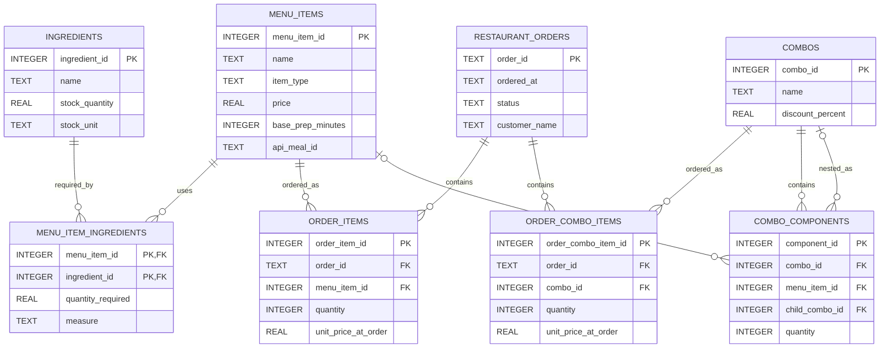

# 3. System Architecture & Object-Oriented Design

## 3.1 Class Hierarchy

The class hierarchy diagram illustrates the inheritance relationships among the menu-related classes of the Restaurant Ordering & Inventory Insights application. It consists of one abstract superclass, `MenuItem`, and four concrete subclasses: `Appetizer`, `MainCourse`, `Beverage`, and `Combo`.

This structure organizes menu items according to their categories while promoting code reusability and maintainability.

### 3.1.1 MenuItem (Abstract Superclass)

The `MenuItem` class serves as the abstract superclass for all menu items in the application. It stores and validates common menu-item information and provides a shared structure for its subclasses. This design reduces code duplication and establishes a consistent way of representing menu items throughout the application.

### 3.1.2 Appetizer (Concrete Subclass)

The `Appetizer` class extends the `MenuItem` class and represents appetizer items offered by the restaurant. It inherits the common menu-item information and behavior defined by its superclass while identifying items belonging to the appetizer category.

### 3.1.3 MainCourse (Concrete Subclass)

The `MainCourse` class extends the `MenuItem` class and represents the main-course items available on the restaurant's menu. It inherits the common menu-item information and behavior defined by its superclass while distinguishing main-course items from other menu categories.

### 3.1.4 Beverage (Concrete Subclass)

The `Beverage` class extends the `MenuItem` class and represents beverages offered by the restaurant. It inherits the common menu-item information and behavior defined by its superclass while identifying items belonging to the beverage category.

### 3.1.5 Combo (Concrete Subclass)

The `Combo` class extends the `MenuItem` class and represents combinations of individual menu items or other combos. It maintains combo components, recursively calculates the total price of nested combos, validates component quantities, and prevents circular references.

## 3.2 Single Responsibility Principle (SRP) Justification

The application follows the Single Responsibility Principle by assigning specific responsibilities to its classes:

- **MenuItem:** Stores and validates common menu-item information. It does not manage the user interface or database operations.
- **Appetizer:** Represents appetizer menu items and their category.
- **MainCourse:** Represents main-course menu items and their category.
- **Beverage:** Represents beverage menu items and their category.
- **Combo:** Manages combo components, calculates nested combo prices recursively, and prevents invalid quantities and circular references.
- **RestaurantOrder:** Stores the order ID, timestamp, and status and ensures that order-status transitions follow the defined rules.
- **KitchenQueue:** Manages FIFO (First-In, First-Out) processing of kitchen orders.
- **OrderHistoryStack:** Tracks recent orders and supports cancellation of the latest order that is still pending.
- **Database:** Manages SQLite database connections and initializes the database schema.
- **MenuItemRepository:** Handles saving, retrieving, and other database operations for menu items using parameterized JDBC statements.
- **DineSmartApp:** Builds the JavaFX interface, handles user interactions, and delegates operations to the appropriate application services and repositories.

Each class has a specific responsibility, separating menu management, combo pricing, order processing, database operations, and user-interface functions. This design improves organization, reduces code duplication, and makes individual classes easier to maintain and test.

---

# 4. Data Model & Database Design

## 4.1 Finalized Entity-Relationship Diagram (ERD)

**Figure 3: Finalized Entity-Relationship Diagram for DineSmart**

The Entity-Relationship Diagram (ERD) illustrates the relational database structure of the DineSmart Restaurant Ordering & Inventory Insights application. The application uses SQLite as its database management system and Java Database Connectivity (JDBC) to execute database operations.

The database consists of eight application tables:

1. `MENU_ITEMS`
2. `INGREDIENTS`
3. `MENU_ITEM_INGREDIENTS`
4. `RESTAURANT_ORDERS`
5. `ORDER_ITEMS`
6. `ORDER_COMBO_ITEMS`
7. `COMBOS`
8. `COMBO_COMPONENTS`

These tables support menu management, ingredient records, customer orders, and meal combo management. Primary keys (PKs) uniquely identify records, while foreign keys (FKs) establish relationships between related tables.

## 4.1 Finalized Entity-Relationship Diagram (ERD)

### Finalized Entity-Relationship Diagram

**Figure 3.** Finalized eight-table Entity-Relationship Diagram showing the database entities, primary keys, foreign keys, and relationships of DineSmart.

## 4.2 Entity and Attribute Definitions

**Table 3: Database Entities and Their Key Attributes**

| Entity | Key Attributes | Description |
|---|---|---|
| `MENU_ITEMS` | `menu_item_id` (INTEGER, PK), `name` (TEXT), `item_type` (TEXT), `price` (REAL), `base_prep_minutes` (INTEGER), `api_meal_id` (TEXT) | Stores restaurant menu items, including their names, categories, prices, preparation estimates, and optional TheMealDB identifiers. |
| `INGREDIENTS` | `ingredient_id` (INTEGER, PK), `name` (TEXT), `stock_quantity` (REAL), `stock_unit` (TEXT) | Stores ingredient information, available stock quantities, and measurement units. |
| `MENU_ITEM_INGREDIENTS` | `menu_item_id` (INTEGER, PK/FK), `ingredient_id` (INTEGER, PK/FK), `quantity_required` (REAL), `measure` (TEXT) | Connects menu items with their required ingredients and records the quantities needed for preparation. |
| `RESTAURANT_ORDERS` | `order_id` (TEXT, PK), `ordered_at` (TEXT), `status` (TEXT), `customer_name` (TEXT) | Stores customer orders, timestamps, order statuses, and customer names. |
| `ORDER_ITEMS` | `order_item_id` (INTEGER, PK), `order_id` (TEXT, FK), `menu_item_id` (INTEGER, FK), `quantity` (INTEGER), `unit_price_at_order` (REAL) | Stores individual menu items included in customer orders, their quantities, and their recorded prices. |
| `ORDER_COMBO_ITEMS` | `order_combo_item_id` (INTEGER, PK), `order_id` (TEXT, FK), `combo_id` (INTEGER, FK), `quantity` (INTEGER), `unit_price_at_order` (REAL) | Stores meal combos included in customer orders, including their quantities and recorded prices. |
| `COMBOS` | `combo_id` (INTEGER, PK), `name` (TEXT), `discount_percent` (REAL) | Stores meal combos, their names, and applicable discount percentages. |
| `COMBO_COMPONENTS` | `component_id` (INTEGER, PK), `combo_id` (INTEGER, FK), `menu_item_id` (INTEGER, nullable FK), `child_combo_id` (INTEGER, nullable FK), `quantity` (INTEGER) | Stores the individual menu items or nested combos that make up a meal combo. |

The database uses SQLite data types such as INTEGER, TEXT, and REAL to store identifiers, names, timestamps, quantities, and monetary values.

The `customer_name` attribute is added to `RESTAURANT_ORDERS` through a database migration for existing databases. Similarly, `discount_percent` is added to older `COMBOS` tables when necessary.

## 4.3 SQLite Schema Description

The DineSmart database schema is implemented using SQLite. Primary keys uniquely identify records, while foreign keys establish relationships between related tables. UNIQUE and CHECK constraints help maintain data integrity. JDBC PreparedStatements are used to bind values in database operations.

**Table 4: SQLite Schema Description (Key Columns and Purpose)**

| Table | Key Columns | Purpose |
|---|---|---|
| `MENU_ITEMS` | `menu_item_id` (PK), `name` (UNIQUE), `item_type`, `price`, `base_prep_minutes`, `api_meal_id` | Stores menu items, categories, selling prices, preparation estimates, and optional TheMealDB identifiers. |
| `INGREDIENTS` | `ingredient_id` (PK), `name` (UNIQUE), `stock_quantity`, `stock_unit` | Stores ingredient information and available inventory quantities. |
| `MENU_ITEM_INGREDIENTS` | `menu_item_id` (PK/FK), `ingredient_id` (PK/FK), `quantity_required`, `measure` | Connects menu items to ingredients and records recipe requirements. |
| `RESTAURANT_ORDERS` | `order_id` (PK), `ordered_at`, `status`, `customer_name` | Stores customer orders, timestamps, statuses, and customer names. |
| `ORDER_ITEMS` | `order_item_id` (PK), `order_id` (FK), `menu_item_id` (FK), `quantity`, `unit_price_at_order` | Stores individual menu items included in customer orders. |
| `ORDER_COMBO_ITEMS` | `order_combo_item_id` (PK), `order_id` (FK), `combo_id` (FK), `quantity`, `unit_price_at_order` | Stores combos included in customer orders, including quantities and recorded prices. |
| `COMBOS` | `combo_id` (PK), `name` (UNIQUE), `discount_percent` | Stores named meal combos and their discount percentages. |
| `COMBO_COMPONENTS` | `component_id` (PK), `combo_id` (FK), `menu_item_id` (nullable FK), `child_combo_id` (nullable FK), `quantity` | Stores the menu items or nested combos that make up each combo. |

The schema uses primary keys, foreign keys, UNIQUE constraints, and CHECK constraints to maintain data consistency. Foreign-key enforcement is enabled when a database connection is established.

The `COMBO_COMPONENTS` table also includes a CHECK constraint requiring exactly one of `menu_item_id` or `child_combo_id` to contain a value. This allows a combo component to reference either an individual menu item or another combo, but not both simultaneously.

## 4.4 Primary Keys and Foreign Keys

Primary keys (PKs) uniquely identify individual records within a database table. Foreign keys (FKs) establish relationships between related records and help maintain referential integrity.

The primary keys used in the database include:

- `MENU_ITEMS.menu_item_id`
- `INGREDIENTS.ingredient_id`
- `RESTAURANT_ORDERS.order_id`
- `ORDER_ITEMS.order_item_id`
- `ORDER_COMBO_ITEMS.order_combo_item_id`
- `COMBOS.combo_id`
- `COMBO_COMPONENTS.component_id`

The `MENU_ITEM_INGREDIENTS` table uses a composite primary key consisting of `menu_item_id` and `ingredient_id`. This prevents duplicate ingredient associations for the same menu item.

The following foreign-key relationships connect the database tables:

- `MENU_ITEM_INGREDIENTS.menu_item_id` references `MENU_ITEMS.menu_item_id`.
- `MENU_ITEM_INGREDIENTS.ingredient_id` references `INGREDIENTS.ingredient_id`.
- `ORDER_ITEMS.order_id` references `RESTAURANT_ORDERS.order_id`.
- `ORDER_ITEMS.menu_item_id` references `MENU_ITEMS.menu_item_id`.
- `ORDER_COMBO_ITEMS.order_id` references `RESTAURANT_ORDERS.order_id`.
- `ORDER_COMBO_ITEMS.combo_id` references `COMBOS.combo_id`.
- `COMBO_COMPONENTS.combo_id` references `COMBOS.combo_id`.
- `COMBO_COMPONENTS.menu_item_id` references `MENU_ITEMS.menu_item_id`.
- `COMBO_COMPONENTS.child_combo_id` references `COMBOS.combo_id`.

The `COMBO_COMPONENTS` table supports nested combos through the self-referencing `child_combo_id` foreign key.

## 4.5 Database Relationships

**Table 5: Database Relationships and Their Descriptions**

| Relationship | Cardinality | Description |
|---|---|---|
| `MENU_ITEMS` and `INGREDIENTS` through `MENU_ITEM_INGREDIENTS` | Many-to-many | A menu item can require multiple ingredients, while an ingredient can be used in multiple menu items. |
| `RESTAURANT_ORDERS` and `ORDER_ITEMS` | One-to-many | A customer order can contain multiple individual menu-item entries. |
| `MENU_ITEMS` and `ORDER_ITEMS` | One-to-many | A menu item can appear in multiple customer order records. |
| `RESTAURANT_ORDERS` and `ORDER_COMBO_ITEMS` | One-to-many | A customer order can contain multiple combo entries. |
| `COMBOS` and `ORDER_COMBO_ITEMS` | One-to-many | A combo can appear in multiple customer orders. |
| `COMBOS` and `COMBO_COMPONENTS` | One-to-many | A combo can contain multiple components. |
| `MENU_ITEMS` and `COMBO_COMPONENTS` | One-to-many, optional | A combo component may reference an individual menu item. |
| `COMBOS` and `COMBO_COMPONENTS` through `child_combo_id` | One-to-many, optional self-reference | A combo component may reference another combo, allowing nested combos. |

The `MENU_ITEM_INGREDIENTS` table resolves the many-to-many relationship between menu items and ingredients.

The `ORDER_ITEMS` and `ORDER_COMBO_ITEMS` tables separate individual menu-item orders from combo orders. This allows customer orders to contain regular menu items and meal combos.

The `COMBO_COMPONENTS` table supports nested combo structures by allowing a combo to contain either individual menu items or other combos.

## 4.6 Design Rules and Constraints

The database and application apply validation rules to maintain accurate and consistent records.

### 4.6.1 Menu Item Constraints

- Menu-item names are required and must be unique.
- Menu-item prices cannot be negative.
- Preparation times cannot be negative.
- The `item_type` field accepts the supported values `APPETIZER`, `MAIN_COURSE`, and `BEVERAGE`.
- The `api_meal_id` field can store an optional TheMealDB recipe identifier.

### 4.6.2 Ingredient Constraints

- Ingredient names are required and unique.
- Ingredient stock quantities cannot be negative.
- Required ingredient quantities must be positive.
- Each menu-item and ingredient association is uniquely identified by its composite primary key.

### 4.6.3 Order Constraints

- Each order must have a unique order identifier.
- Order timestamps are required.
- Order statuses must be one of the supported values: `PENDING`, `PREPARING`, `COMPLETED`, or `CANCELLED`.
- Order-item quantities must be positive.
- Combo-order quantities must be positive.
- Recorded unit prices cannot be negative.

The `ORDER_ITEMS` and `ORDER_COMBO_ITEMS` tables store `unit_price_at_order`. This preserves the recorded price of an item or combo even if its current price changes later.

### 4.6.4 Combo Constraints

- Combo names are required and unique.
- Combo discounts must be at least zero and less than 100 percent.
- Combo-component quantities must be positive.
- Each combo component must reference either an individual menu item or another combo.
- Circular combo references are prevented through application-level validation.
- Nested combo prices are calculated recursively.

The `COMBO_COMPONENTS` table uses a CHECK constraint to ensure that exactly one of `menu_item_id` or `child_combo_id` is provided for each component record.

### 4.6.5 Referential Integrity

Foreign-key relationships help prevent invalid references between database tables.

The application enables SQLite foreign-key enforcement whenever a database connection is established through the `Database.connect()` method.

These constraints help maintain consistency among menu items, ingredients, customer orders, combos, and combo components.

## 4.7 Database Support for Application Features

The database provides the relational foundation for the main functions of the DineSmart application.

### Menu Management

The `MENU_ITEMS` table stores menu information, including item names, categories, prices, and preparation estimates.

### Ingredient Records

The `INGREDIENTS` and `MENU_ITEM_INGREDIENTS` tables represent ingredient information, stock quantities, measurement units, and the ingredient requirements associated with menu items.

### Customer Order Management

The `RESTAURANT_ORDERS`, `ORDER_ITEMS`, and `ORDER_COMBO_ITEMS` tables represent customer orders, individual ordered items, and ordered combos.

### Combo Management

The `COMBOS` and `COMBO_COMPONENTS` tables support meal combinations, discount percentages, and nested combo structures.

### Recipe Integration

The `api_meal_id` attribute allows imported menu items to be associated with recipe information from TheMealDB.

### Sales Information

Order timestamps, quantities, recorded prices, and order statuses provide information that can be used for sales reporting and analysis.

